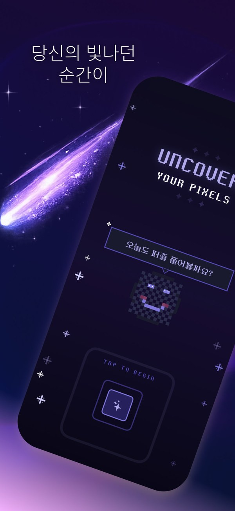
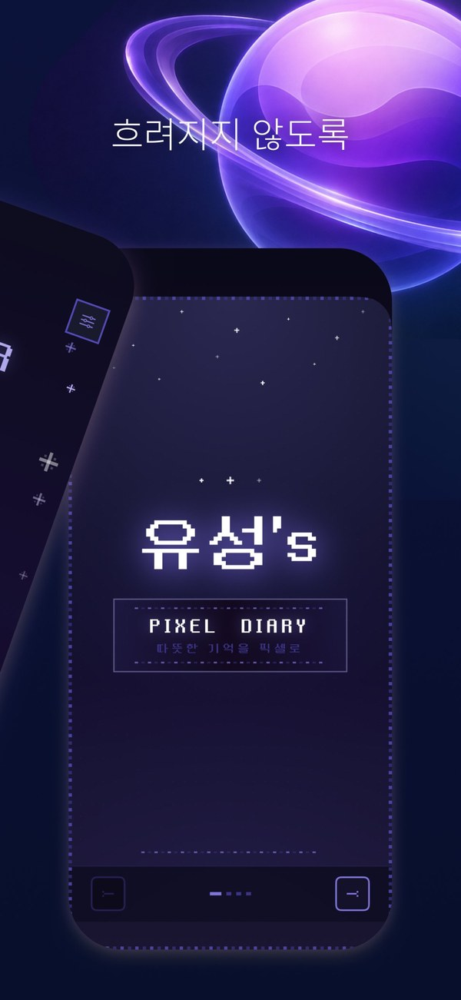
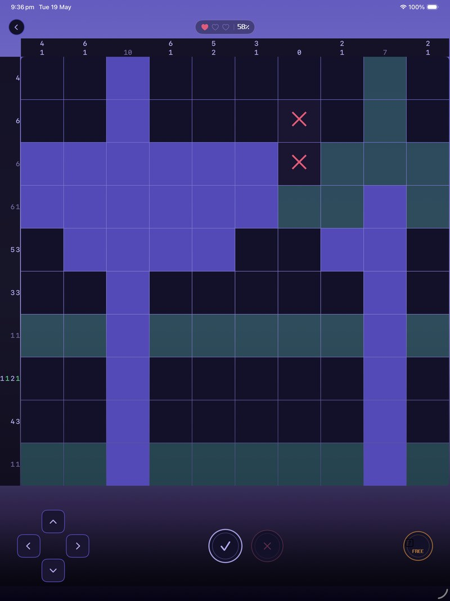

<p align="center">
  
</p>

<h1 align="center">Uncover Pixels</h1>

<p align="center">사진을 노노그램 퍼즐로 바꿔 풀고, 일기로 남기는 iOS 앱</p>

<p align="center">
  <a href="https://apps.apple.com/kr/app/uncoverpixels/id6769139305"></a>
  
  
</p>

<p align="center">
  
  
  
  
  
</p>

> 전체 소스는 비공개 | 이 저장소에는 퍼즐 규칙·이미지 파이프라인·플레이 상태 관리 등 핵심 모듈 4개와 설계 설명만 공개 | 코드의 재배포 및 상업적 이용 불가
> 1인 개발(기획·디자인·개발·운영) | 2026.04 ~ 운영 중 | 개발에 Claude Code 적극 활용

<br>

## 동작 흐름

1. 사진 선택
2. 120×120 픽셀로 축소 후 밝기 기준 흑백 노노그램 도안 생성
3. 도안을 15×15(노말, 64타일) 또는 20×20(하드, 36타일)로 잘라 타일 하나씩 풀기
4. 타일을 풀 때마다 그 부분의 원래 색이 드러나고, 전부 풀면 사진 완성
5. 제목과 한 줄 일기를 붙여 다이어리에 저장, 날짜·제목 스탬프를 찍어 사진 앱으로 내보내기

<br>

## 아이패드 화면

<table>
<tr>
<td align="center"><br/>홈</td>
<td align="center"><br/>플레이 — 힌트 · 목숨 · 진행률</td>
<td align="center"><br/>다이어리 표지</td>
</tr>
</table>

<br>

## 퍼즐 완성

<table>
<tr>
<td align="center" width="50%"></td>
<td align="center" width="50%">
  <br/>
  
</td>
</tr>
<tr>
<td valign="top">
<b>타일 완성 → 캐스케이드</b><br/>
마지막 칸을 채우면 대각선 순서(row+col)로 셀이 뒤집히며 흑백 도안이 원래 색으로 바뀜 | 목숨·진행률은 상단, 힌트는 우하단
</td>
<td valign="top">
<b>완성 후 내보내기</b><br/>
타일을 전부 풀면 원본 사진이 드러나고, 날짜와 한 줄 제목을 스탬프로 찍어 갤러리에 저장 가능
</td>
</tr>
</table>

<br>

## 기술 스택

| 영역 | 사용 |
|---|---|
| UI | SwiftUI (iOS 26) |
| 이미지 처리 | Core Image (CIUnsharpMask·CIColorControls), CGContext 픽셀 버퍼 |
| 인증 | Firebase Auth — 게스트(익명) → Google / Apple 계정 연결 |
| 저장 | Firestore (PersistentCache로 오프라인 열람·로컬 우선 쓰기) |
| 수익화 | AdMob 리워드 광고(힌트·이어하기), StoreKit 2 광고 제거 상품 |
| 디자인 시스템 | 색·글꼴·간격 토큰과 공용 컴포넌트 (아래 참고) |
| 사운드 | AVFoundation — .ambient 세션, 다른 앱 음악과 공존 |
| 기타 | Crashlytics, PhotosUI, 햅틱 |

<br>

## 이 저장소의 구성

```
Core/
├── DesignSystem/
│   ├── AppColor.swift                색 토큰 61개
│   ├── AppFont.swift                 글꼴 단계 11개
│   ├── AppSpacing.swift              간격·모서리
│   ├── AppGradient.swift             배경 그라데이션 (MeshGradient 팔레트 3종)
│   └── Components/                   PixelButton, PixelTextField, PixelCircleButton,
│                                     PixelPanel, LoadingOverlay
├── Models/NonogramModel.swift        퍼즐 규칙 — 힌트 계산, 탭/마킹/목숨, 완성 판정
├── Services/
│   ├── ImagePixelizer.swift          사진 → 노노그램 변환 파이프라인
│   └── BGMPlayer.swift               배경음악 — 세션 관리, 페이드, 멈춤 사유 관리
└── ViewModels/PlayViewModel.swift    플레이 상태, 힌트·이어하기, 진행 저장/복원
Features/
└── Nonogram/NonogramGridView.swift   그리드 뷰 — 축 고정 드래그 채우기, 커서, 캐스케이드
docs/                                 스크린샷
```

전체 앱 구조(비공개 부분 포함):

```
UncoverYourPixels/
├── App/                     진입점, Firebase·AdMob 초기화
├── Core/Models, Services, ViewModels
├── Features/Onboarding, Play, Nonogram, Diary, Main, Settings
├── Resources/               에셋, 배경음악, Easy 공식 퍼즐 42개(4카테고리)
└── Shared/                  공통 컴포넌트
```

<br>

## 디자인 시스템

출시 후 화면을 늘리는 동안 색과 글꼴이 뷰 파일 안에 흩어졌다. 작업 전에 세어보니 `Color(hex:)` 호출이
316회에 고유 색 58개, 글꼴 이름 문자열이 98회였다. 같은 보라색이 파일마다 다른 값으로 적혀 있거나,
이름과 실제 색이 어긋난 항목(`red`에 보라색이 들어 있는 식)도 있었다.

### 토큰

- `AppColor` — 팔레트는 상위 8색이 전체 사용의 80%였다. 그 8색에 쓰임새 이름을 붙이고
  (`purple`, `surface`, `textDim`, `danger`), 화면별로 쓰이던 색도 쓰임에 맞게 올렸다
  (`hint`, `marking`, `cellInLine`)
- `AppFont` — 글꼴 이름 문자열을 없애고 크기를 11단계로 정리
- `AppSpacing` / `AppRadius` — 4의 배수 기준
- `AppGradient` — 온보딩 배경. `MeshGradient`로 세 팔레트를 만들어 Preview에서 비교하고 하나를 골랐다

교체는 화면 단위로 끊어 커밋했다. 출시 중인 앱이라 한 번에 바꾸면 어디서 어긋났는지 찾기 어렵다.
지금 뷰 파일에 남은 색·글꼴 하드코딩은 0개이고, 퍼즐 도안처럼 런타임에 값이 정해지는 것만 남겼다.

### 컴포넌트

| 컴포넌트 | 모은 곳 | 비고 |
|---|---|---|
| `PixelButton` | 6개 화면 | 모서리 8·12·각진 사각형, 패딩 14·16, 글자 16·18·22로 제각각이던 것 |
| `PixelTextField` | 2개 화면 | 글자 수 제한, 포커스 표시 |
| `PixelCircleButton` | 3개 화면 | 원형 뒤로가기 |
| `LoadingOverlay` | 3개 화면 | 저장 중·변환 중·광고 로딩 |
| `PixelPanel` | — | 각진 테두리 패널 |

버튼은 모으면서 두 가지를 고쳤다. 비활성 상태에서도 글자가 흰색이라 눌리는 줄 알고 누르게 되던 것,
그리고 누름 반응이 전혀 없던 것이다. 각 컴포넌트에는 상태별 `#Preview`를 붙였다.

<br>

## 핵심 로직

### 사진 → 퍼즐 (`ImagePixelizer`)

- EXIF 회전 정규화 → 언샤프 마스크·대비 1.3으로 윤곽 강조 → 120×120 리사이즈
- 밝기(`0.299R + 0.587G + 0.114B`) 임계값으로 흑백화. 사진마다 밝기가 달라 고정 임계값으로는 너무 비거나 꽉 차므로, 채움 비율 30~60%에 들어올 때까지 임계값을 ±0.07씩 최대 6회 조정
- 타일로 자른 뒤 밀도 18% 미만·82% 초과이거나 빈 행/열이 2개를 넘는 타일은 퍼즐로 성립하지 않으므로 blob 성장 방식의 랜덤 도안으로 교체(각 행·열 최소 1칸 보장)
- 채도 0.2 이상 픽셀을 16단계 버킷으로 묶어 가장 많은 버킷의 평균색을 대표색으로 추출 → 다이어리 배경에 사용

### 플레이 (`NonogramModel`, `PlayViewModel`, `NonogramGridView`)

- 힌트 자동 계산, 탭/마킹/목숨(노말 5·하드 8), 행·열·힌트 블록 단위 완성 판정
- 드래그 채우기: 첫 4pt 이동으로 가로/세로 축 고정, 시작 칸~현재 칸을 범위로 채움. 첫 오답에서 중단해 목숨 연속 차감 방지
- 타일별 진행 상태를 UserDefaults에 저장 → 중간에 나가도 이어서 풀기 가능
- 완성 시 대각선 순서(row+col)로 셀이 뒤집히는 캐스케이드 연출

### 저장·오프라인 (`FirestoreService`)

- 사진 한 장 = `users/{uid}/diaries/{id}` 문서 하나. 타일별 흑백·컬러 픽셀을 함께 저장
- 타일 완성·제목 수정 같은 UI 경로의 쓰기는 `await` 없이 호출. Firestore가 즉시 로컬에 기록하고 네트워크 복구 시 동기화하므로 오프라인에서도 화면이 멈추지 않음
- 빈 문자열은 Firestore 경로로 쓸 수 없어 런타임 크래시 → 모든 경로에 가드

### 광고 (`AdService`)

- 리워드 광고 로드에 7초 타임아웃. 로드·표시 실패 시 보상 그대로 지급(광고 때문에 게임이 막히지 않도록), 중복 지급은 플래그로 차단
- 광고 제거 상품 구매 시 광고 없이 즉시 보상

<br>

### 배경음악 (`BGMPlayer`)

- `.ambient` 세션 — 기기 무음 스위치를 존중하고 다른 앱의 음악을 끊지 않는다
- 사용자가 음악을 듣고 있으면(`isOtherAudioPlaying`) 배경음악을 아예 틀지 않는다
- 퍼즐을 푸는 동안과 광고 중에는 물러난다. 처음에는 퍼즐 화면의 `onDisappear`에 걸었는데,
  광고가 전체 화면으로 뜨면 SwiftUI가 그 화면에 퇴장을 보내 꺼져 있던 음악이 다시 올라왔다.
  멈춤을 사유(퍼즐·광고) 집합으로 바꾸고, 퍼즐 쪽은 화면이 아니라 `PlayViewModel`의 수명에 걸었다
- 반복 이음새에 공백이 생기지 않도록 mp3가 아니라 caf로 넣었다

<br>

## 타임라인

| 시기 | 내용 |
|---|---|
| 2026.03~04 | 기획·디자인, 노노그램 코어, 이미지 파이프라인, 다이어리, 온보딩 |
| 2026.05.19 | App Store 출시 |
| 2026.05 | iPad 배경색·그리드 비율 수정, 갤러리 대표색 캐시, 리워드 광고·광고 제거 상품 |
| 2026.09 | 오프라인 쓰기 멈춤, 게스트 로그인 실패 크래시, 드래그 목숨 연속 차감, 타일 진행 저장 — 네 건 수정 |
| 2026.11 | 디자인 시스템 분리와 공용 컴포넌트 추출, 온보딩 개편, 배경음악 추가 |
| 2026.11 | 나갔다 들어오면 목숨이 차던 문제, 이름 짓기 전에 완성 처리되던 문제 수정 |

<br>

## 빌드에 대해

이 저장소만으로는 빌드 불가
공개된 파일은 `UIKit`·`SwiftUI`·`CoreImage`·`AVFoundation`만 사용하며, `Color(hex:)` 확장은 `AppColor.swift`에 함께 공개. `PlayViewModel`이 참조하는 `AdService`(광고)와 `StoreService`(결제)만 비공개 모듈에 있음 (전체 소스 열람이 필요하면 연락 바람)

<br>

## 한계

- 광고 실패 시 보상 지급 정책 수정 필요
- 다이어리 문서에 컬러 픽셀을 통째로 넣어 문서 하나가 700KB 안팎. Firestore 한 문서 한도가 1MiB라
  여유가 많지 않음. 제목·메모 길이 제한으로 당장은 막아뒀고, 이미지를 Storage에 두고 참조하도록 수정 예정
- 간격 토큰(`AppSpacing`)은 정의만 해두고 아직 화면에 적용하지 않음. 색과 달리 값을 맞추면 간격이
  실제로 달라져서 화면마다 눈으로 확인하며 바꿔야 함
- 단위 테스트 없음. 노노그램 규칙과 픽셀화는 순수 함수라 붙이기 쉬운 편

<br>

## 폰트

- [Neo둥근모 Pro](https://neodgm.dalgona.dev/) — SIL Open Font License
